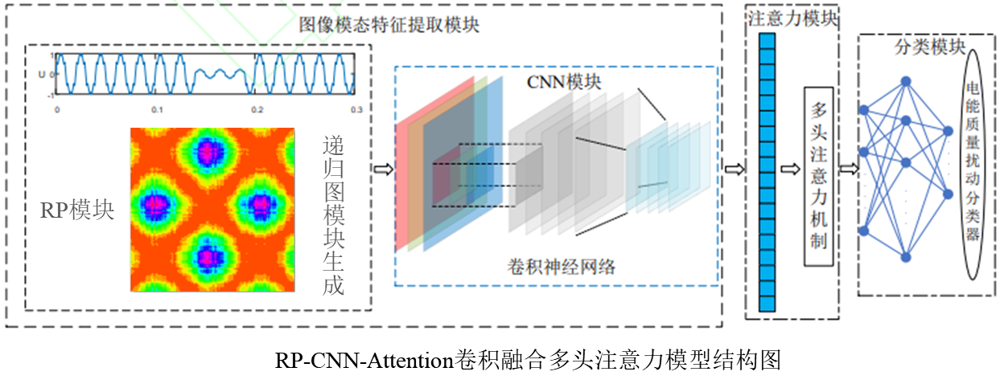
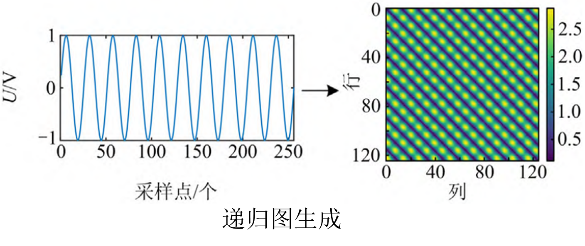
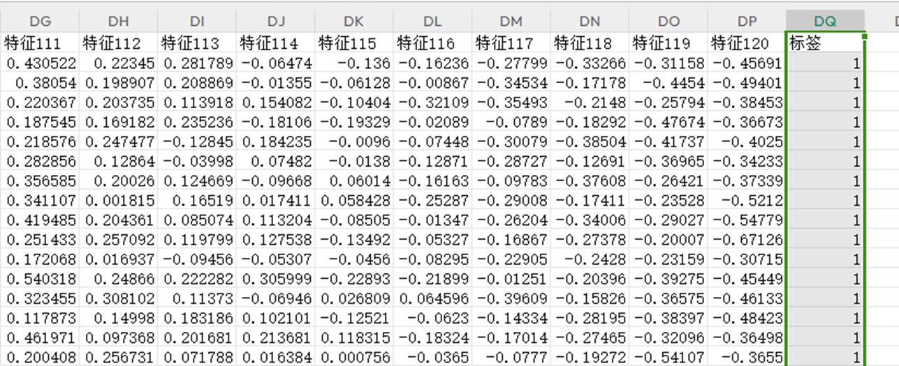
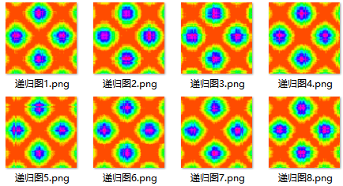
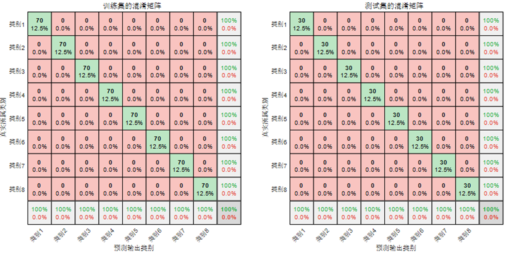
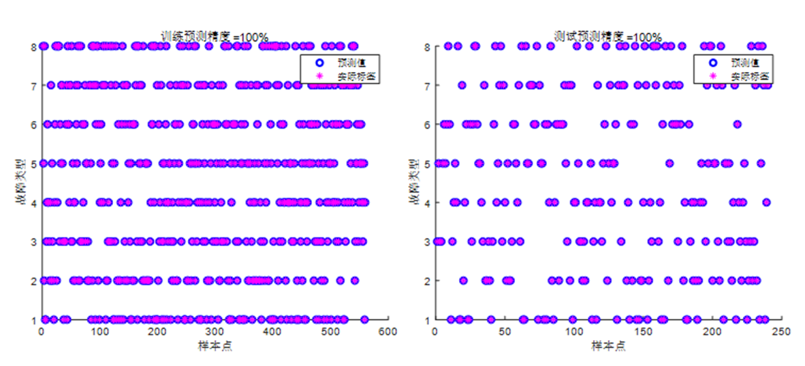
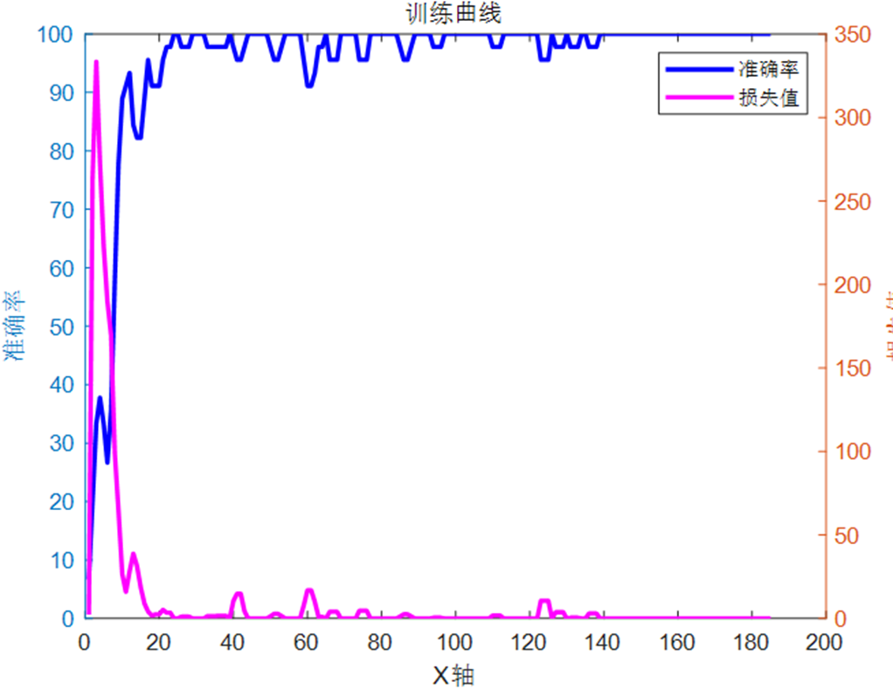

# First Launch Improvement! RP-CNN-Attention Based on Recursive Graph RP and Convolutional Neural Network Fusion Multi-Head Self-Attention Mechanism for Fault Identification, MATLAB Program

The document is applicable to platforms: MATLAB 2023 and above.

1. An Excel-formatted fault dataset.
2. A time-series to image conversion program containing recursive graph (RP).
3. A resolution modification program.
4. A CNN-Attention fault diagnosis program.

The application domain is suitable for various data classification scenarios, such as rolling bearing faults, transformer oil gas faults, power system transmission line fault areas, insulators, distribution networks, and disturbances in electric energy quality, etc., for recognition, diagnosis, and classification.

The Markov Field (MTF) diagram of this document has been converted into a recursive graph (RP). The innovation lies in the combination of the recursive graph (RP) with Convolutional Neural Networks (CNN), incorporating multi-head attention mechanisms, to achieve fault classification. The RP converts one-dimensional signals into two-dimensional feature maps, while CNN can perform adaptive feature extraction and classification on these feature maps. The integration of multi-head attention mechanisms effectively captures the contribution of extracted features, achieving accurate fault classification.

The fault identification process is as follows:

Principle: Recursive graph is a time series visualization method in the field of non-stationary signals, which reveals internal information of time series, providing predictiveness, information content, and similarity prior knowledge for analyzing non-stationarity, chaos, and periodicity of time series. Therefore, it is used to mine the latent features of power quality signals and visualize them in two dimensions.
Taking the voltage sine signal as an example, the RP schematic diagram is shown below:

The method of fault recognition using RP-CNN-Attention has several innovative aspects:
Data Representation Innovation: Typically, one-dimensional sequences (such as time series data) are directly used for modeling and analysis. Transforming these sequences into Markov Field images is a novel method of data representation. This transformation may reveal new patterns and structural features in the sequence data that might not be as obvious or difficult to detect in their original one-dimensional form. It outperforms traditional time series analysis methods in capturing complex patterns and anomalies more effectively.
Image Processing Techniques: By converting sequence data into images, mature image processing techniques and image recognition algorithms can be utilized for data analysis. This includes employing various image recognition methods such as Convolutional Neural Networks (CNN), which have proven highly effective in the field of image analysis but are less common in traditional sequence data analysis.
Capturing Time Dependentness: Recursive graphs are mathematical models used to represent the dependencies between random variables. They reveal the chaotic nature, stationarity, and inherent similarity of time series, uncover hidden features of fault waveforms, and enhance fault characteristics. When transforming sequence data into recursive images, time-dependent and dynamic changes within fault waveforms can be captured in the form of images, providing a new perspective for understanding and identifying fault patterns in time series.
Multi-Head Attention Mechanism: The integration of multi-head attention mechanisms effectively grasps the contribution of extracted features, focusing on enhancing key features to improve the accuracy of fault identification.
Programmatic Application: Recursive Graphs (RP) generate two-dimensional images from one-dimensional time series, followed by CNN to extract high-dimensional features. With the help of Multihead Self-Attention (Multihead Self-Attention), features are emphasized, improving the accuracy of fault identification.
Input Data Format: (Each row represents a sample, with the last column indicating the category label of the fault)

Generated RP Images:

Identification Results: (Confusion matrix for training set and test set)

Training Set and Test Set Scatter Plots:
\n        \n  Training Curve: Accuracy and Loss Change Graphs

## Images

<!-- PAYMENT_BLOCK -->

## Get this dataset

- Payment link (Stripe): [Buy now](https://buy.stripe.com/3cs8yP7sY87d0vu9AB)
- Payment QR code: 

<!-- /PAYMENT_BLOCK -->
